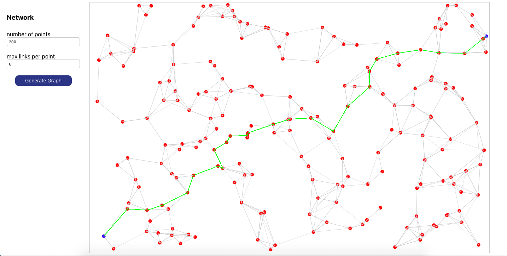

# Network generator

Generate a network of n points
Display it in a browser, find the two most distant points, use Dijkstra's
algorithm to find the shortest path between them, and draw the path.

Built with React, TypeScript, and Vite.

```sh
npm install
npm run dev
```

Run `npm test` for tests and `npm run build` for a type-checked production build.


